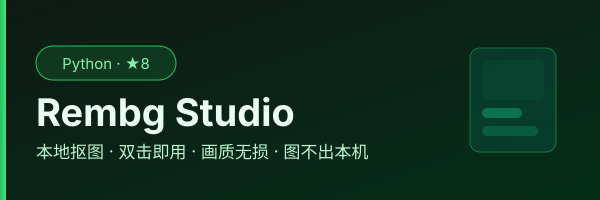

<p align="center">
  
</p>

<div align="center">
  
</div>

# Rembg Studio

**Rembg Studio** 是一款面向桌面和移动设备的 AI 图像去背景、抠图与图片处理工作台。桌面程序使用 Python / FastAPI 提供本地服务，前端通过浏览器打开；项目也提供 Android 与 Web 版本。

> **发布状态**：正式安装包与 WebGPU 实验分支相互独立。WebGPU U2Netp 已在 AMD RDNA 3 上完成实机推理测试；BRIA 大模型的 WebGPU 执行仍在调试，不能将其标为已支持的正式功能。

## 功能

- **一键去背景**：导入 PNG、JPEG、WebP 图片，通过多种 ONNX 模型获得透明背景结果。
- **商品图工作台**：批量导入、设置商品画布规格与留白、选择背景，导出成品及 ZIP 交付包。
- **SAM 辅助抠图**：使用点选或框选方式选择需要保留的对象，改善复杂场景的分割体验。
- **局部修正**：裁剪、旋转，以及针对抠图结果的区域恢复与编辑功能（具体以当前版本 UI 为准）。
- **本地模型管理**：查看模型是否安装，按需下载；部分模型需另行遵守商用授权要求。
- **手机访问**：可在局域网内通过浏览器访问桌面工作台；Android 另有 APK 发行产物。

## 下载与安装

- [GitHub Releases：正式版本与安装包](https://github.com/lilyco-42/rembg-ui/releases)
- [LYCO 多平台下载页面](https://lain42.top/downloads/rembg-ui/index.html)
- [Windows、Linux、macOS、Android、iOS 下载说明](docs/RELEASE-DOWNLOADS.zh-CN.md)

| 平台 | 发布形式 |
| --- | --- |
| Windows | ZIP 桌面发行包 |
| Linux | tar.gz 桌面发行包 |
| macOS | ZIP 应用发行包，注意系统安全与签名限制 |
| Android | 按 ABI 提供 APK，商店发行可使用 AAB |
| iOS / iPadOS | 可使用 Web/PWA；尚无已验证签名的原生 IPA |

**Linux 提示**：下载后的完整目录需要一起解压并运行，不要仅复制 `rembg-ui` 单个可执行文件。如果启动时报错，请保留终端日志排查动态库或打包兼容性。

## 源码运行

建议先安装 Python、[uv](https://docs.astral.sh/uv/) 和 Git。

```bash
git clone https://github.com/lilyco-42/rembg-ui.git
cd rembg-ui
uv sync
uv run python main.py
```

启动后打开终端提示的本地地址。默认仅监听 `127.0.0.1`；需要同一 Wi-Fi 下的手机访问时，可以使用：

```bash
uv run python main.py --lan
```

**注意**：局域网模式会向同一网络开放服务，请仅在可信网络中使用，不要直接暴露至公网。公网部署必须另行配置鉴权、代理与安全策略。

## WebGPU AI 加速（技术预览）

实验分支：[`feat/desktop-webgpu-inference-20261028`](https://github.com/lilyco-42/rembg-ui/tree/feat/desktop-webgpu-inference-20261028)

- [WebGPU 中文使用教程、国内模型镜像、CPU/GPU 基准测试](docs/WEBGPU_GUIDE.zh-CN.md)
- [本机 AMD RDNA 3 性能对比图](docs/benchmarks/cpu-vs-webgpu-rdna3.svg)
- [原始测试数据](docs/benchmarks/amd-rdna3-2026-10-28.json)
- [技术预览 PR #11](https://github.com/lilyco-42/rembg-ui/pull/11)

该实验使用浏览器 WebGPU 执行 U2Netp ONNX 推理。模型通过国内镜像优先下载、断点续传并校验 SHA-256，ONNX Runtime Web 运行时可离线打包。**商用额度计费尚未与客户端 GPU 执行路径统一，因此实验模式默认禁用，不应直接作为付费正式版销售。**

## 技术与目录

- 后端：Python、FastAPI、rembg、ONNX Runtime。
- 前端：HTML / JavaScript，桌面本地 Web UI。
- 构建：Nuitka 桌面分发、Android 构建流程、Web/PWA。
- `main.py`：本地服务及 API。
- `frontend/`：桌面 Web UI 与 WebGPU Worker。
- `web/`：Web/PWA 项目。
- `android/`：Android 项目。
- `scripts/`：构建、模型与性能测试工具。
- `docs/`：教程、部署说明及测试记录。
- `.github/workflows/`：CI 和发行工作流。

## 许可与反馈

请查阅仓库 [LICENSE](LICENSE) 以及各个模型自己的许可证。特别注意 **BRIA RMBG** 等模型可能需要额外的商业授权；项目代码的许可不自动授予模型商业使用权。

遇到问题请在 [GitHub Issues](https://github.com/lilyco-42/rembg-ui/issues) 提交系统版本、安装包版本与终端错误日志。
