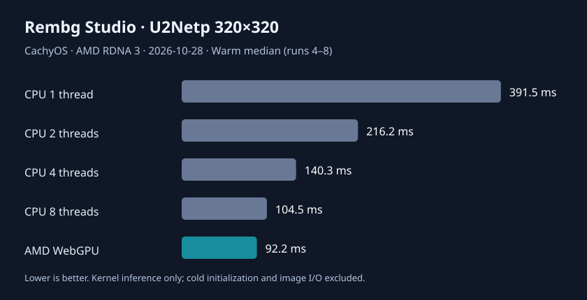

# Rembg Studio WebGPU AI：国内下载、上手教程与实测

> 2026-10-28 技术预览。功能属于 PR #11 实验分支，尚未合并商用正式版。WebGPU 使用 **U2Netp** 而非 BRIA RMBG-2.0，画质不可等同。

## 零基础启动（源码版）

1. 安装 Python、uv、Node.js/npm，克隆本项目并切到 feat/desktop-webgpu-inference-20261028 分支。
2. 在项目目录依次运行以下命令，国内 HF 与 npm 镜像优先，支持重试与模型断点续传、校验。
3. 运行应用，在网页中上传照片，勾选 **⚡ 实验性 WebGPU AI 推理（U2Netp）**，点击运行。成功显示 WebGPU U2Netp 与推理耗时。需要支持 WebGPU 的 Chrome/Chromium/Edge。
4. 开发阶段须显式设置 REMBG_ENABLE_WEBGPU_EXPERIMENT=1；发布版本默认关闭，防止绕过商用额度计费。

Linux / macOS:

    python scripts/download_webgpu_model.py
    uv run --no-project --with onnx python scripts/prepare_webgpu_model.py
    python scripts/install_webgpu_runtime.py
    REMBG_ENABLE_WEBGPU_EXPERIMENT=1 uv run python main.py

Windows PowerShell:

    python scripts/download_webgpu_model.py
    uv run --no-project --with onnx python scripts/prepare_webgpu_model.py
    python scripts/install_webgpu_runtime.py
    $env:REMBG_ENABLE_WEBGPU_EXPERIMENT="1"
    uv run python main.py

默认模型目录 ~/.u2net/，原模型 u2netp.onnx，转换后模型 u2netp-webgpu.onnx；浏览器运行时本地化到 frontend/vendor/ort/。Windows 打包流程会调用 npm.cmd。构建已加入下载运行时步骤，运行时无需访问 jsDelivr。

## 常见问题

- HTTP 403：实验开关未开启，或页面安全 Token 不正确。
- HTTP 404：先下载和转换模型；确认 u2netp-webgpu.onnx 已存在。
- HTTP 503：先安装 WebGPU 离线运行时。
- WebGPU 不可用：检查 chrome://gpu、显卡驱动、浏览器版本；不应伪装为 CPU 的 GPU 加速。
- 首次推理慢：WebGPU 编译 Shader、创建模型会话需额外时间；预热与冷启动不能混淆。
- 下载慢：使用 hf-mirror.com 优先，支持 .part 文件恢复；运行时使用 registry.npmmirror.com，失败回退官方 npm。校验失败不把模型当成功下载。

## 本机 GPU / CPU 公平基准

CachyOS，AMD HawkPoint 核显（浏览器报告 AMD RDNA 3），Chromium 156，U2Netp ONNX 320×320，输入 1×3×320×320 float32；输入 x[i] = sin(i × 0.007)，CPU 使用 ONNX Runtime CPU 1.31.1，GPU 使用 ORT WebGPU 1.22.0。每种方式测 8 次，下表预热中位数基于第 4 至 8 次。

| 推理方式 | 首次推理 | 预热中位数 | vs 单线程 CPU |
|---|---:|---:|---:|
| CPU 1 线程 | 462.2 ms | 391.7 ms | 1.00× |
| CPU 2 线程 | 291.0 ms | 216.2 ms | 1.81× |
| CPU 4 线程 | 182.5 ms | 140.3 ms | 2.79× |
| CPU 8 线程 | 173.9 ms | 104.5 ms | 3.75× |
| AMD WebGPU | 416.1 ms | 92.2 ms | 4.25× |

**结论：WebGPU 连续推理比 8 线程 CPU 仅快约 1.13 倍**。GPU 会话创建另约 751 ms，单张图可能反而不划算。以上不含图像解码、传输、预处理、保存 PNG、显存占用、完整 UI 总时长，不能直接作为商业宣传的端到端加速倍数。

原版 33 个 MaxPool ceil_mode=1 在 WebGPU 无法执行，已转换为兼容形式；相同输入的 CPU 对比 MAE=0，GPU 实测可输出透明 PNG。**仍需对更多真实图片做全像素输出误差、细发丝/透明边缘画质回归。**

- 原始逐次数据：[本机基准 JSON](benchmarks/amd-rdna3-2026-10-28.json)
- 重新生成图表：python scripts/render_gpu_benchmark.py
- 重跑 CPU：uv run --no-project --with numpy --with onnxruntime python scripts/bench_cpu_u2netp.py

## 上架与跨平台限制

Linux AMD 实机 GPU 推理通过；Windows 与 macOS 的 CI 仅验证模型转换、运行时下载和 CPU 输出一致性，并不能代表显卡实机运行。正式发布前，还需真实 Windows NVIDIA/Intel 及 macOS Apple GPU 实测、产品真实图片批处理与 UI 回归、商业许可和服务器端计费保障。

### 浏览器 GPU 实机自动复测

先准备已下载模型与运行时，并安装测试依赖：

    npm install --no-save playwright-core
    node scripts/bench_webgpu_u2netp.cjs

测试脚本使用 Chromium 无头浏览器实际创建设备、执行 8 次 ORT WebGPU 前向推理，并检查输出的 320×320 共 102400 个数值；结果打印运行时间、GPU Adapter 厂商及架构。Linux 默认浏览器路径 /usr/bin/chromium；可通过 CHROMIUM_BINARY 环境变量指定其他平台安装位置。它需要 GPU 直通的图形运行环境，CI 不能只因脚本存在就宣称有真实 GPU。

第二轮复测：AMD RDNA 3，会话创建 860.3 ms、预热中位数 93.1 ms（与首轮 92.2 ms 一致性较好）。

### CI 验证范围

2026-10-28 Actions 运行 40707408217：Windows / Linux 的模型转换、离线运行时安装、CPU 输出验证通过；macOS Job 被取消，不能作为此轮成功结果。此前一轮 macOS 测试通过，但它仍不是苹果 GPU 的真实推理验证。请以 GitHub Actions 最新 run 为准。

## 大模型 FP16 性能优化实验（2026-10-28）

- 本机已有 BRIA RMBG ONNX 模型 **977 MiB**，算子图 **7,267 节点**，输入为动态 H×W；其推理计算量远高于 U2Netp，不可套用轻量模型的 92 ms 基准。
- 新增保守的 FP16 转换工具：模型原始文件不覆盖、转换前检查可用内存和磁盘、转换后进行 ONNX checker，并且写入新文件。Linux 开发测试示例：

      uv run --no-project --with onnx --with onnxconverter-common --with numpy python scripts/prepare_large_webgpu_fp16.py --input ~/.u2net/bria-rmbg.onnx --output ~/.u2net/bria-rmbg-webgpu-fp16.onnx

- 本机转换成功，结果约 **490 MiB**（513,577,080 bytes），校验 SHA-256 为 `3f281cbac29e7a95eddd424ef565ea3cff88fe75546fe09901bd571fcdb3e2d4`。
- 首次 Chromium / AMD RDNA 3 / ONNX Runtime WebGPU 1.22.0、512×512 全图前向测试 **失败**，页面只抛出异常码 `1046310184`，原因尚未定位，**没有大模型 WebGPU 的成功推理、性能或者画质成绩**。
- FP16 轻模型独立试验：原模型 4.4 MiB → FP16 2.3 MiB，WebGPU 实际推理预热中位数约 81.5 ms（先前 FP32 92–93 ms），但 FP16 和 FP32 输出出现数值偏差，尚不能证明抠图画质一致。

**后续优化顺序**：先找出大模型 GPU 加载异常的具体算子/图形节点并做正确性回归；然后做 512 与 1024 分辨率显存峰值、冷启动与热运行分析；接着核验 FP16 透明边缘质量；最后才考虑模型量化与按显卡能力自动选模型。不要在商用 UI 中展示尚未验证的大模型 GPU 加速。
